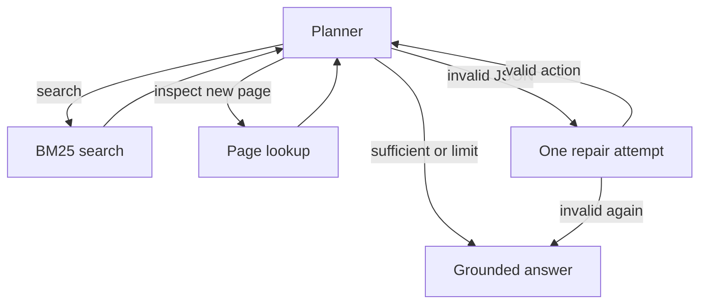

# Capstone Checkpoint 5.1

Research Paper Navigator — Council Wooten III

## Deliverable

Upload only Council_Wooten_Required_Capstone_Checkpoint_5_1_Worksheet.docx for this checkpoint. Keep code and evidence in this repository for the final Module 8 repository submission.

## What changed in the agent’s behavior

The agent received clearer instructions and more complete evidence. This is similar to revising a superintendent’s inspection procedure and supplying the full report before the next decision. The underlying model and keyword search method stayed the same.

| Step 3 example | Implemented change | Meaning |
|---|---|---|
| Improving system prompts | Added separate title searches, paper-identity checks, no reopening of collected pages, and acknowledgement of missing support | Clearer directions for the model’s next action |
| Adjusting workflow structure | Added one JSON repair attempt per invalid planning response | A recovery step when a tool instruction has the wrong format |
| Modifying retrieval behavior | Directed the agent to search each named paper and open new pages when needed | Changed how the agent is instructed to use the existing search tools; did not replace the search algorithm |
| Improving how the agent uses retrieved information | Replaced shortened previews with full collected-page text | More complete evidence available for deciding the next step |

The refined run recovered from two planning-format errors and avoided T2’s repeated-page loop. Remaining citation and attribution errors are documented in CAPSTONE_5_1_REVIEW.md. Better instructions improved some observed behavior but did not guarantee correct answers.

## Reading the worksheet

The worksheet uses plain language. It presents three comparison tasks (T1–T3), plus a simple lookup (T0), and explains the measured results without assigning an unsupported overall accuracy score. The September 22 wording revision changes documentation only; the tested code, recorded calls, and measurements remain unchanged.

## Architecture



The diagram is conceptual: a valid repair supplies the current action directly without another planning call. An execution limit or invalid-output stop does not prove sufficient evidence. The answer uses collected pages and the baseline evidence-only prompt.

## Files and provenance

- capstone_checkpoint_5_1_agent_rag_starter.py: unchanged MIT demonstration.
- capstone_checkpoint_5_1_agent_rag_solution.py: first generated three-task version; not the measured initial run.
- capstone_checkpoint_5_1_agent_rag_control.py: measured initial version, four tasks.
- capstone_checkpoint_5_1_agent_rag_refined.py: measured refined version.
- CAPSTONE_5_1_REVIEW.md: findings, evidence checks, limitations.
- CAPSTONE_5_1_EVALUATION.json: reproducible metrics extracted from results.
- results/initial_20260921T235507_391261Z/: eight fixed/initial-agent answers and calls.
- results/refined_20260922T001038_071778Z/: four refined-agent answers and calls.

Dependencies are in the existing Checkpoint 3.1 environment. Verified versions: Python 3.12.14, pypdf 6.16.2, rank-bm25 0.2.2, langchain-openai 1.1.10, langchain-core 1.3.2, python-dotenv 1.2.2. Corpus verification uses Checkpoint 3.1 input/config.json; retrieval imports the unchanged Checkpoint 2.1 baseline. All 153 PDFs match the manifest; extraction yielded 6,059 pages, with the form-content omission warning documented in the review.

## Reproduction

From the repository root, activate the existing environment and set CORPUS_DIR to the research-paper directory. The root .env supplies OPENROUTER_API_KEY; never commit it.

```bash
source capstone-project/capstone-checkpoint-3.1/MIT_Checkpoint_3_1_Evaluation/.venv/bin/activate
python capstone-project/capstone-checkpoint-5.1/capstone_checkpoint_5_1_agent_rag_refined.py --check --repo "$PWD" --corpus "$CORPUS_DIR"
```

Replace --check with --run only for an intentional paid rerun. Every run creates a new timestamped results folder. Initial: at most 24 calls; refined: at most 36 including repairs. No transport retries. Existing experiments already suffice for this worksheet; no rerun is needed for filing.

## Interpretation

The agent improves evidence gathering on some comparisons but adds overhead to a simple lookup. JSON repair and fuller context improve execution without fixing all citation and attribution errors. These are development-case observations, not production-readiness evidence. No vector retrieval, MCP server, or knowledge graph is implemented in this checkpoint.
